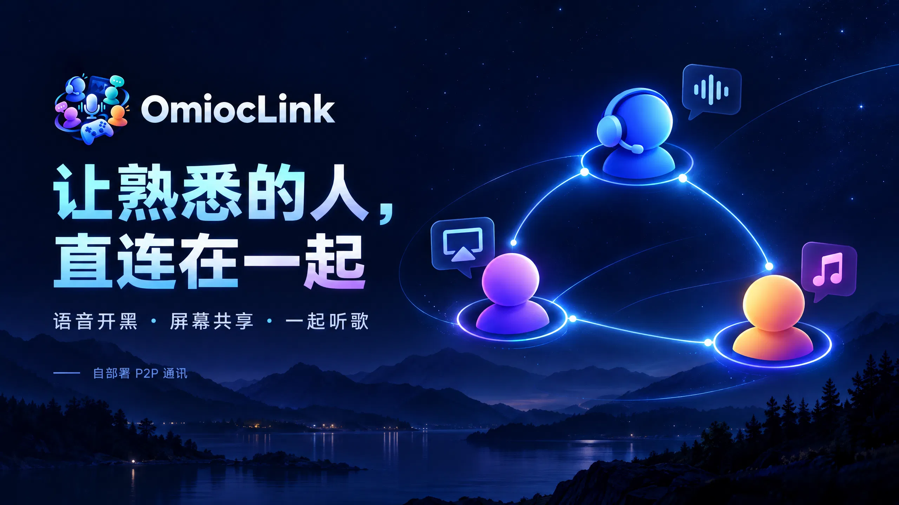
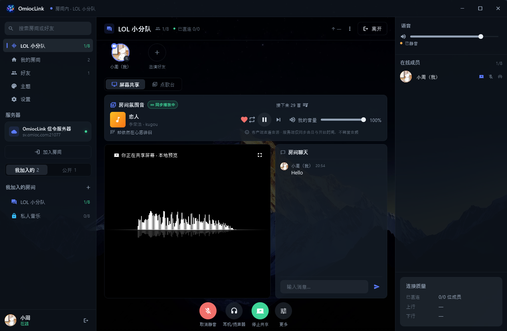
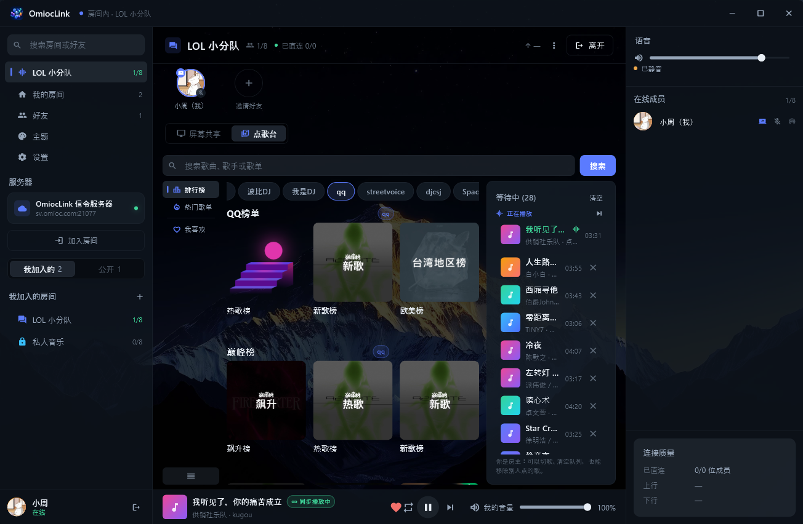
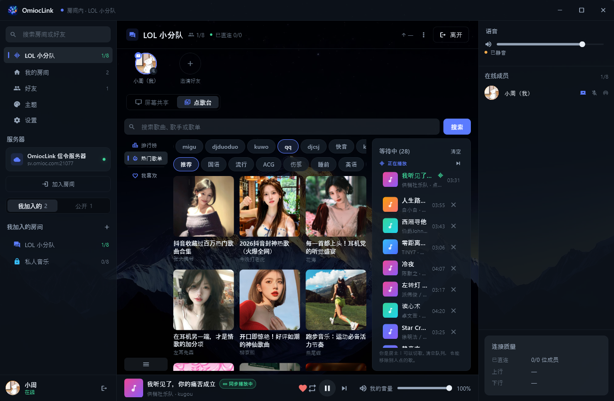
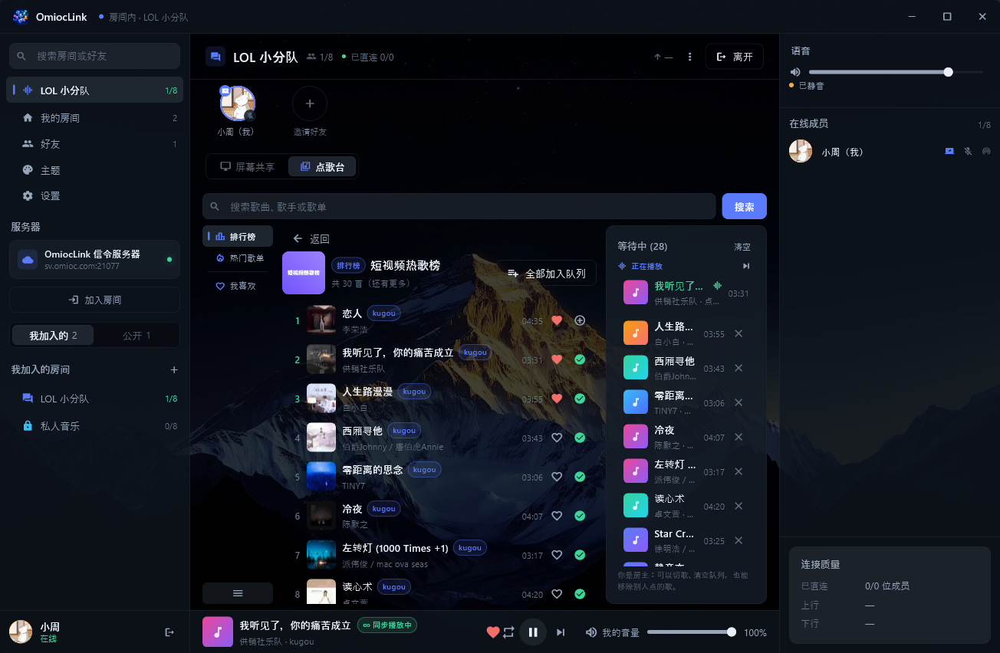
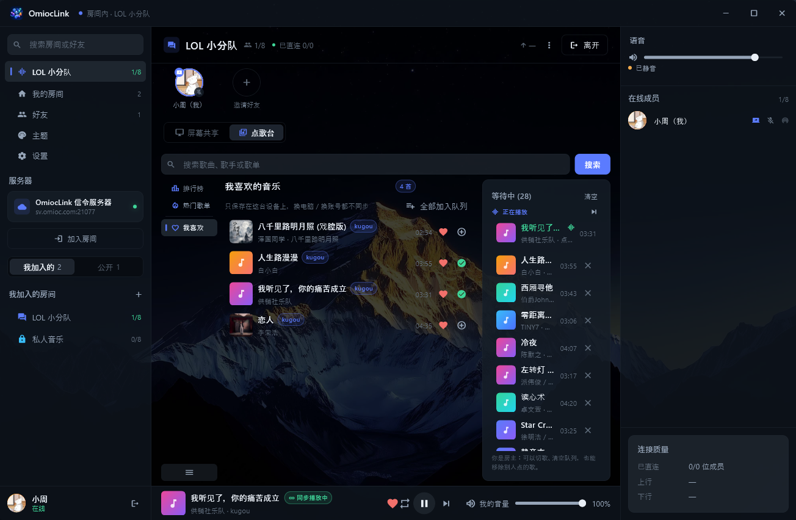
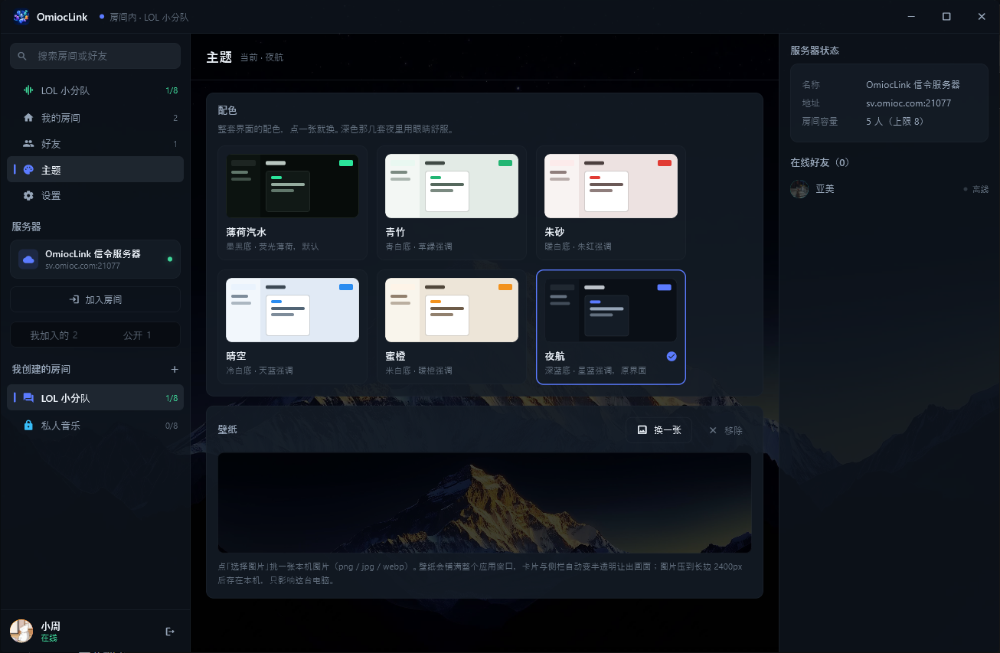

<h1 align="center">
   OmiocLink
</h1>

<b>语言 / Languages:</b> <a href="README.md">中文</a> · <a href="README.en.md">English</a> · <a href="README.ja.md">日本語</a> · <a href="README.ko.md">한국어</a>

  A self-hosted peer-to-peer P2P communication app built for small circles — <b> voice chat while gaming, game screen sharing, listening to music and watching together </b>

  Two steps to your own private circle: 1. deploy the server with one command 2. install the client

  <a href="https://github.com/omioc/omioclink/releases/latest/download/omioclink-client-win-x64-1.0.8.zip">Download the Windows portable build</a>
  &nbsp;|&nbsp;
  <a href="https://github.com/omioc/omioclink/releases/latest/download/omioclink-client-android-1.0.8-arm64-v8a.apk">Download the Android APK</a>
  &nbsp;|&nbsp;
  <a href="https://hub.docker.com/r/omioc/omioclink">Server image (Docker Hub)</a>
   
  <a href="server/README.md">Server deployment</a>
  &nbsp;|&nbsp;
  <a href="client/README.md">Building, debugging and packaging the mobile client</a>

---

## 1. About OmiocLink

OmiocLink is a desktop communication tool **for you and a fixed group of friends**. Run a signaling service on a small public-facing Linux box, have a few friends install the client, and you can voice chat while gaming, watch the same screen and listen to music together

It is made up of two parts:

| Directory | Contents |
| --- | --- |
| `client/` | Flutter client: Windows desktop + Android; iOS is on the way and help is eagerly welcome |
| `server/` | FastAPI signaling server + home-grown STUN + web admin console, including an offline deployment compose file and an image export script (see [server/README](server/README.md)) |
| `deploy/` | Compose file used for online server deployment: pulls the Docker Hub image only; deployment steps in [server/README](server/README.md) |

One design constraint runs through the whole OmiocLink project, and every feature is built on top of it:

> **The server only handles signaling and state and never relays media**. Voice, screen and chat all travel directly between members (WebRTC + DTLS-SRTP). The server **has no media relay module** and does not deploy TURN — server traffic is always on the order of KBs

Good fit for: a fixed small circle of 2–8 people gaming together, watching videos or matches together, late-night listening sessions, or remotely checking a friend's screen — with the guarantee that none of that data passes through any third-party service

---

## 2. Features

Desktop screenshots use the **夜航** (Night Voyage, deep blue) theme; mobile demos use the mobile default **青竹** (Green Bamboo, green-on-white) theme

| In-room · Screen sharing | Song Station · Leaderboard | Song Station · Popular playlists |
| :---: | :---: | :---: |
|  |  |  |

| Song Station · Song chart | Song Station · Favorites | Themes and appearance |
| :---: | :---: | :---: |
|  |  |  |

### 2.1 Peer-to-peer transport: media never touches the server, and there is no proxy or relay

- **Mesh topology**: on joining a room, each member opens one PeerConnection to every other member, so latency is a single hop; rooms are capped at 2–8 people, which is exactly the size where mesh pays off
- **The server relays exactly three things**: SDP (offer/answer), ICE candidates, and room and member state — all JSON of a few KB, while media flows directly between the two ends from the very first frame
- **No relay, and no "proxy the traffic" option**: there is no TURN server and no relay process anywhere on the server; the price is that **if hole punching fails, you simply cannot connect**, so use it with your network conditions in mind (with stun mode enabled on the server, Settings can detect the current client's network mode and whether it is usable)
- **On the same LAN it stays on the LAN**: host candidates let members on the same WiFi connect directly, with latency under 5 ms and zero external traffic
- **Across networks it relies on STUN hole punching**, which the industry puts at roughly 80–90% success (the vast majority of home routers are cone NAT); symmetric NAT (common on carrier CGNAT) and campus or corporate networks that block UDP will fail
- **Failures are spelled out too**: connectivity is probed before you join, and members you cannot reach are flagged in the UI; Settings → Current connection shows **x/y members directly connected** plus uplink/downlink bitrate in real time, and offers actionable advice when a member fails to hole-punch (switch to a phone hotspot / switch home broadband / check whether the firewall blocks UDP)
- **STUN can be self-hosted**: `cd deploy && docker compose --profile stun up -d` starts a STUN server whose only job is answering "what is my public mapping?" — it relays no media either

### 2.2 Shared voice

- The mic opens as soon as you join a room; capture applies echo cancellation / noise suppression / automatic gain control (AEC / NS / AGC) and encodes with Opus
- Each member gets a tile in the member list: speaking level, connection quality and mute state (mute state is broadcast to the whole room by the server)
- **Three independent local volume controls**, all of which affect only your own machine and are never reported to the server:
  - Music volume (0–100)
  - Per-member volume (0–200, remembered per `userId` and restored automatically after reconnecting, rejoining or restarting)
  - Microphone volume (0–100, which directly adjusts the system volume of the default recording device — i.e. how loud the other side hears you)
- The output device can be switched (headset / speakers), and hot-plugging a device refreshes the list automatically
- The mobile client (**青竹** theme; below 600 dp on the short edge it switches to a single column with bottom navigation) reuses the same call logic, with the right-hand column turned into a bottom panel

### 2.3 Screen sharing

- Pick **a whole monitor or a single window** (with thumbnails), and optionally **share system audio** as well — the sound of the game or movie you are sharing goes out with it (on speakers the other side may hear echo, so headphones are recommended)
- Three **encoding strategies** to match what you are sharing (the default, Balanced, decides for itself):

| Preset | Best for | Frame rate | When bandwidth is tight |
| --- | --- | --- | --- |
| Frame rate first | Game streaming | Constant 60fps (never below 30) | Lower the resolution first, keep the frame rate |
| Resolution first | Meetings / documents / presentations | Starts at 30fps, rises to 60 when there is budget to spare | Lock the source resolution, no scaling |
| Balanced | Everyday use | Automatic (30 / 60) | Judges from the average QP whether the picture is high-motion or static, then decides which to protect |

- **No manual bitrate tuning**: the 30 Mbps uplink budget is split by viewer count (2K source + 3 viewers ≈ 9 Mbps per stream), and resolution and frame rate step down automatically as the budget shrinks; the floor is **720p / 30fps** — when streaming a game, dropped frames are less acceptable than a soft image

- Viewers go fullscreen in one click (Esc to exit), and the sharer can stop or switch sources at any time
- The right-hand column of the room page is "screen sharing + chat + queue"; chat messages travel over a **DataChannel** (peer-to-peer), and the server neither stores nor forwards any chat content or history
- Screen sharing is not available on Android (`getDisplayMedia` has no Android implementation), and system-level microphone volume control may not be available there yet either

### 2.4 Song Station (**MusicFree compatible**)

The Song Station has no built-in audio sources; it **runs MusicFree plugins** instead:

- The server only stores the **plugin subscription URLs**; all audio and music metadata come from plugins executed **locally on each client** in a QuickJS sandbox — the server does not proxy, cache or serve any audio
- Three views that map one-to-one to MusicFree: **Search** (search box at the top, two levels of tabs for type × source, results appear as you type), **Leaderboards** and **Popular playlists**
- Each source times out independently (2s for all sources / 8s for a specific source / 4s for leaderboards), and three consecutive failures trip a 5-minute circuit breaker; failures stay out of the main viewport, leaving only a small "N sources failing" entry next to the search box
- Search results are cached locally for 6 hours; Settings lets you enable/disable/reorder/uninstall plugins, update all of them, configure `userVariables`, and choose audio quality (Smooth / Standard / High / Lossless)
- **Once suitable source plugins are installed**, there should be no need to hop between multiple apps to listen to most of your music — how well it works depends on the quality of the plugins you configure

### 2.5 Listening together (synchronized room playback)

Playback in a room is not "everyone plays their own copy"; it is **server-authoritative with clock alignment**:

- The queue lives on the server, and every change broadcasts a full snapshot (`revision` increases monotonically), so who requested what, which position it holds and who skipped are identical on every client
- **Playback progress comes from clock synchronization**: clients estimate their offset the SNTP way using ping/pong (keeping only the lowest-RTT samples and trusting the server clock only), instead of each guessing from "the moment I pressed play"
- **Permissions have hard edges**: anyone can request songs (88 per person in the queue by default); the room owner or the requester of the current track can skip; only the owner can clear the queue. The client merely hides buttons you have no permission for, and the server still has the final say
- When a track ends, the next one starts automatically (clients report EOS, and the server handles it idempotently by `revision`)
- **Playback mode is room-wide**: repeat all (default) / repeat one / sequential / shuffle. The button to the left of play/pause cycles through them, and everyone in the room sees the same mode; changing modes does not interrupt the current track
- Lyrics scroll along the LRC timeline in step with local playback progress; when no lyrics are available it shows "Intro… / No lyrics" — it never blocks playback and never spins
- The screen sharing page has a "room ambience" card at the top and a permanent "Now playing" bar at the bottom
- Reconnecting after a drop, or leaving and rejoining, replays the server snapshot (the dedup key is "session + revision", not the bare revision), so you never get the "everyone left but the music keeps playing" state

### 2.6 Rooms · Friends · Chat

- Create a room with a name, a member cap (2–8) and an optional password; copy the room number and share it with friends in one click
- Friends: search by username, send requests, accept/decline, online status, remove friends
- In-room text chat goes over a P2P DataChannel, so the server cannot see the content

### 2.7 Themes and appearance

- Six themes: **薄荷汽水** (Mint Soda, desktop default), **青竹** (Green Bamboo, mobile default), 朱砂 Cinnabar, 晴空 Clear Sky, 蜜橙 Honey Orange and **夜航** (Night Voyage, the recommended desktop palette)
- Custom wallpapers are supported; the light and dark variants invert text and control colors, all driven by one shared palette
- Frameless desktop window with a custom-drawn title bar, minimum 1120×720

### 2.8 Logs and feedback

- Every run writes one log file, and startup prunes files older than 7 days; Settings → Runtime logs shows the current file path directly and offers "Open log folder"
- Native crashes additionally drop a crash report (module list, platform thread stacks, minidump)

---

## 3. Current status

**What already works**: the Windows client is feature-complete (voice, screen sharing, Song Station, listening together, friends and rooms, themes, logs and crash reports); Android is largely usable as well

**The current blocker: building and shipping iOS**

The code already separates the desktop and mobile layouts (below 600 dp on the short edge it collapses to a single column), Android runs the same code without problems, and porting to iOS would not be much work; what is missing is an **Apple Developer Program** account, so there is no signing, no TestFlight and no App Store listing

> **If a kind sponsor can cover the $99/year Apple developer account, it would be hugely appreciated** — it would help an iOS release land sooner and take this project from "a Windows tool I use myself" to "a self-hosted product present on all three platforms"; sponsors will be thanked in the sponsor list

Other known issues:

- **Connections cannot be established on symmetric NAT or UDP-blocking networks**: this is the price of the relay-free architecture, and diagnostics plus hints guiding users to change networks are the only remedy
- **A few MusicFree plugins can crash the client** (native stack overflow in the QuickJS bridge layer, `0xc00000fd`); the current mitigation is a larger thread stack and capped HTTP concurrency, with continued tuning to follow
- Android releases are still debug-signed and not published anywhere yet; to try it today, download the APK from the releases page and install it manually

---

## 4. Key technologies and acknowledgements

| Area | What we use |
| --- | --- |
| Real-time media | **WebRTC** (`flutter_webrtc`) plus home-grown mesh networking, ICE restart and bitrate presets; DTLS-SRTP encryption, media never lands on the server |
| Connectivity discovery | Home-grown **STUN** (Python, address echo only), which you can self-host or replace with a public STUN server |
| Signaling | **FastAPI + WebSocket** with a home-grown JSON protocol (camelCase, machine-readable error codes, application-level ping/pong heartbeat and clock sync) |
| Storage | **SQLite + SQLAlchemy async** (`aiosqlite`) for accounts/friends/rooms/subscriptions; avatars stored on a data volume |
| Music plugins | **QuickJS** (`quickjs_engine`) sandbox running **MusicFree plugins**, with the host bridging HTTP / storage / common Web globals |
| Playback | **media_kit** (libmpv) playing direct URLs, LRC lyric parsing, SNTP-style clock alignment |
| Audio devices | Windows Core Audio for microphone system volume, device enumeration and hot-plug |
| UI | Flutter frameless window (`window_manager`) with six theme palettes and responsive three-column desktop / single-column mobile layouts |

### Special thanks to MusicFree

The whole plugin ecosystem behind the Song Station is **MusicFree**'s doing: the plugin protocol, plugin installation and version rules, directory structure, the way search results are presented, and the card styles for charts and playlists all reference (and align with) [MusicFree](https://github.com/maotoumao/MusicFree) and its desktop implementation

Without MusicFree's open and clean plugin spec, this project's Song Station would probably have stopped at "a few built-in platform APIs"; sincere thanks to the author and to everyone who writes plugins

> This project **ships no audio sources**; plugins are distributed by the server administrator via subscription URLs and executed locally by each client, and audio requests go straight from the client to the URLs returned by the plugin, never through the OmiocLink server

---

## 5. Contributing: issues and PRs

### Before filing an issue

1. Search the existing issues first to avoid duplicates
2. State the **version** (file names in `releases` carry it, or check the About page in the client), the **system** (Windows 10/11, Android version) and the **network environment** (home broadband / campus network / corporate network / phone hotspot, and whether a proxy or VPN is in use)
3. **Attach logs and crash stacks whenever possible** — it is the single best way to make remote debugging easier

#### Where the logs are and how to share them

- Directory: **`%LOCALAPPDATA%\OmiocLink\logs`** (a portable build keeps them in `logs\` next to the exe; on phones they live in the app's private directory, and Settings shows the full path)
- How to open it: in the client, **Settings → Runtime logs → "Open log folder"**; the page also shows the log file path for the current run directly
- Files in that directory (recognize them by prefix):

| File name | What it is |
| --- | --- |
| `client-<时间>.log` | One per run; the ordinary runtime log (joining rooms, signaling, media, song requests and errors all land here) |
| `crash-<时间>-<pid>.log` | **Native crash report**: exception code, module base addresses, full module list, crashing thread and platform thread stacks |
| `crash-<时间>-<pid>.dmp` | minidump of all thread stacks; open it directly in WinDbg / VS to inspect call stacks |
| `native-<时间>-<pid>.log` | Startup info: the C++ runtime version actually loaded on this machine (the first place to look for "it only crashes on one machine") |

- Logs older than 7 days are pruned at startup, so **zip them up as soon as a problem appears**
- The easiest option: zip the whole `logs` directory and attach it to the issue; it contains your server address and usernames, so **delete anything you do not want public before posting**
- Android crashes: `adb logcat -s flutter`, or copy out the files from the log directory shown in Settings

### Submitting a PR

- Fork → create a descriptively named branch → change only the files this work needs
- Write comments **in Chinese**, explaining why the code is written that way (pitfalls hit, where a constraint comes from)
- Client: `flutter analyze lib test` reports no error/warning and `flutter test` is fully green; **do not run a repo-wide `dart format`** (this repo is not format-clean, and formatting everything produces a huge, noisy diff)
- Server: `uv run pytest`, `uv run ruff check .` and `uv run mypy` come back clean
- In the PR description, spell out **what changed, why, and how it was verified** (which tests you ran, whether it was checked on real devices or real networks); state anything unverified honestly
- For UI changes, please attach **before and after** comparison screenshots

---

## 6. Sponsorship and donations

If OmiocLink saved you a subscription, a cloud drive, or just gave you and your friends a few more nights of laughs, you are welcome to buy the author a coffee

All sponsorship goes first to the **Apple Developer Program**, then to domain and server costs

| Alipay | WeChat |
| :---: | :---: |
|  |  |

>  You can also add WeChat with a note about what it is for

Other ways to help:

- File an issue that includes logs and reproduces reliably, or submit a PR
- Write a usable, stable MusicFree plugin
- Run it on another device and tell us what is not adapted well

## 7. License

This project is open source under the [MIT](LICENSE) license: free to use, modify, distribute and use commercially, as long as the copyright and license notice are retained

## 8. Community

Thanks to the [LINUX DO](https://linux.do) community; if you are learning AI, L is the place to be

---

  <b>Thanks for using OmiocLink. Sponsorship and donations are welcome; business enquiries — wx: omioc212</b>

  I am omioc, the big big boss, about to land in the world!

