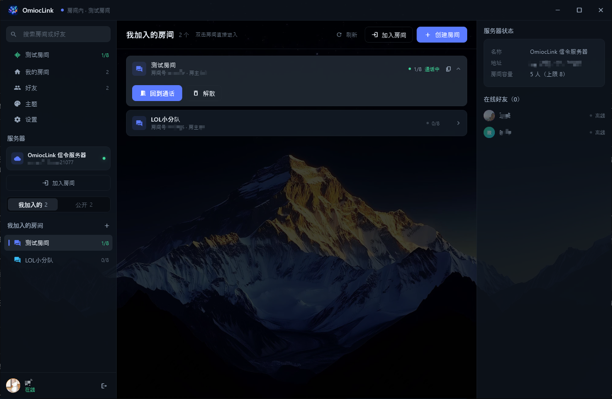
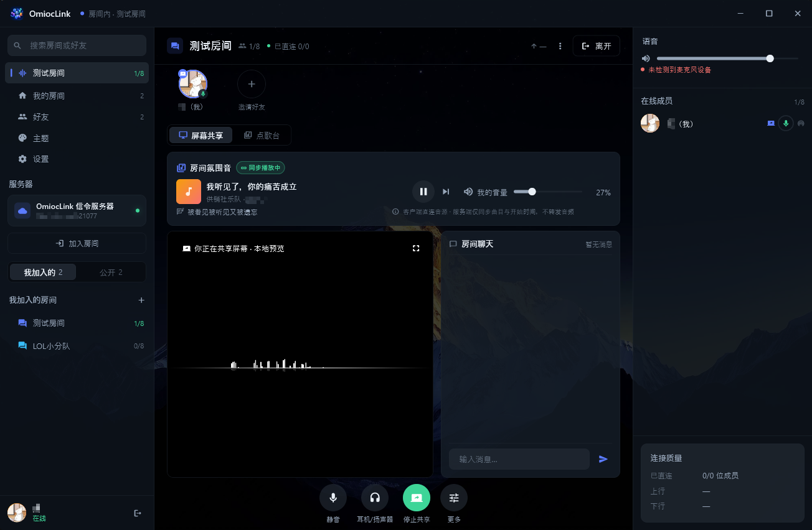
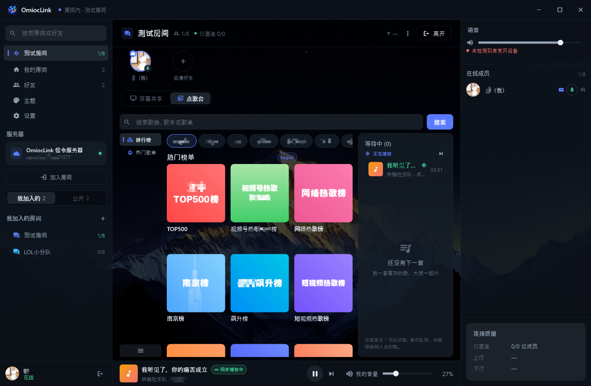

<p align="center">
  
</p>

<h1 align="center">OmiocLink</h1>

<p align="center">
  自部署的实时对点对通信应用 —— <b>给自己和固定好友使用的桌面通讯工具，一起开黑、一起听歌</b>
</p>

<p align="center">
  <a href="https://github.com/omioc/omioclink/releases/download/v1.0.2/omioclink-client-win-x64-1.0.2.zip">Windows 免安装版下载</a>
  &nbsp;|&nbsp;
  <a href="https://github.com/omioc/omioclink/releases/download/v1.0.2/omioclink-client-android-1.0.2.apk">Android APK 下载</a>
  &nbsp;|&nbsp;
  <a href="https://github.com/omioc/omioclink/releases/download/v1.0.2/omioclink-server.tar">服务端镜像离线包</a>
</p>

---

## 1. 关于 OmiocLink

OmiocLink 是一个**给自己和固定好友使用**的桌面通讯工具，你在一台公网 Linux 小机器上跑一个信令服务，几位朋友装上客户端，就能语音开黑、看同一块屏幕、一起听歌


两部分组成：

| 目录 | 内容 |
| --- | --- |
| `client/` | Flutter 客户端：Windows 桌面 + Android，iOS 在路上迫切希望得到助力 |
| `server/` | FastAPI 信令服务器 + 自研 STUN + Web 管理台；`server/docker-compose.yml` 在本机构建并启动 |
| `deploy/` | 服务端在线部署所用 compose：只拉 `omioc/omioclink:latest` 镜像，`docker compose up -d` 即起（可选 STUN profile） |

有一条设计约束贯穿整个 OmiocLink 项目，所有功能都建立在它之上：

> **服务器只做信令与状态，永不转发媒体，** 语音、屏幕、聊天都在成员之间直连（WebRTC + DTLS-SRTP），服务器**不做媒体转发模块**，也不部署 TURN —— 服务端的流量永远是 KB 级的

适合的场景：2~8 人的固定小圈子开黑、一起看片/看比赛、深夜一起听歌、远程帮朋友看屏幕，且希望这些数据不经过任何第三方服务

---

## 2. 功能介绍

桌面端截图取自 **夜航**（深蓝）主题，涉及手机端演示则使用移动端默认的 **青竹**（绿白）主题

| 主界面（房间列表） | 房间内 · 屏幕共享 | 点歌台 |
| :---: | :---: | :---: |
|  |  |  |

### 2.1 点对点通讯：媒体不经过服务器，也没有任何代理/中继

- **Mesh 组网**：进房后每人对房间内其他成员各建一条 PeerConnection，延迟只有一跳；房间人数上限 2~8 人，正好是 mesh 最划算的规模
- **服务器只转三类东西**：SDP（offer/answer）、ICE 候选、房间与成员状态，全是几 KB 的 JSON，媒体从第一帧起就在两端直传
- **没有中继，也没有"代理流量"这个选项**：服务器上不存在 TURN，也不存在任何 relay 进程，代价是**打洞失败就是连不上**，请配合你的网络状况使用（服务端开启 stun 模式后，设置里可以检测当前客户端的网络模式及是否可用）
- **同局域网自动走内网**：host 候选让同一个 WiFi 下的成员直连，延迟 < 5ms、零外网流量
- **跨网靠 STUN 打洞**，业界经验成功率约 80%~90%（家用路由器绝大多数是锥型 NAT），对称型 NAT（运营商 CGNAT 常见）、封 UDP 的校园网/企业网会失败
- **失败也要说清楚**：入房前会探测连通性，连不上的成员在界面里被标出来；设置页「当前连接」实时显示 **已直连 x/y 位成员**、上行/下行码率，并在有成员打洞失败时给出可操作建议（换手机热点 / 换家庭宽带 / 查防火墙是否拦 UDP）
- **STUN 可以自建**：`cd deploy && docker compose --profile stun up -d` 起一个只回答「你的公网映射地址是什么」的 STUN，同样不转发任何媒体

### 2.2 共享语音

- 进房即开麦，麦克风采集开启回声消除 / 噪声抑制 / 自动增益（AEC / NS / AGC），编码 Opus
- 成员列表里每人一格：说话电平、连接质量、静音状态（静音状态由服务器广播给全房间）
- **三条互不干扰的本机音量**，全部只影响自己、不上报服务器：
  - 音乐音量（0~100）
  - 每个成员的音量（0~200，按 `userId` 记住，重连、重进房、重启后自动恢复）
  - 麦克风音量（0~100，直接调本机默认录音设备的系统音量，也就是「对方听到的我的大小」）
- 输出设备可切（耳机 / 扬声器），设备热插拔会自动刷新列表
- 手机端（**青竹**主题，短边 < 600dp 自动切单栏 + 底部导航）复用同一套通话逻辑，只是把右栏改成底部面板

### 2.3 屏幕分享

- 选择**整个显示器或单个窗口**（带缩略图），可选择**同时共享系统声音** —— 共享的游戏/电影声音一起送出去（外放时远端可能听到回声，建议佩戴耳机食用）
- 三档**编码策略**，按共享的内容选（默认「均衡」，会自己判断）：

| 档位 | 适合 | 帧率 | 带宽吃紧时 |
| --- | --- | --- | --- |
| 帧率优先 | 游戏投屏 | 60fps 恒定（不低于 30） | 先降分辨率，帧率不动 |
| 分辨率优先 | 会议 / 文档 / 演示 | 30fps 起，预算富余时提到 60 | 锁源分辨率，不缩放 |
| 均衡 | 寻常场景 | 自动（30 / 60） | 按平均 QP 判断画面是高动态还是静止，再决定保谁 |

- **码率不用手调**：从 30 Mbps 上行预算里按观众人数切分（2K 源 + 3 个观众 ≈ 每路 9 Mbps），分辨率与帧率随预算自动降档，地板是 **720p / 30fps** —— 投屏游戏掉帧比糊更不能接受

- 观看方一键全屏（Esc 退出），共享者可随时停止/更换源
- 房间页右栏是「屏幕共享 + 聊天 + 队列」，聊天消息走 **DataChannel**（点对点），服务器不存储转发任何聊天信息和历史记录
- Android 端不提供屏幕共享（`getDisplayMedia` 无安卓实现），麦克风系统音量控制可能也暂未提供

### 2.4 点歌台（**MusicFree 兼容**）

点歌台的音源不是内置的，而是**跑 MusicFree 插件**：

- 服务器只保存「插件订阅地址」，音频与音乐元数据全部由**各客户端在本地**用 QuickJS 沙箱执行插件得到 —— 服务器不代理、不缓存、不下发任何音频
- 三个视图，与 MusicFree 一一对应：**搜索**（顶部搜索框，类型 × 音源双层 tab，边搜边出结果）、**排行榜**、**热门歌单**
- 每个音源独立超时（全部音源 2s / 指定音源 8s / 榜单 4s），连续失败 3 次熔断 5 分钟；失败不占主视觉，只在搜索框旁边留一个「N 个音源异常」的小入口
- 搜索结果本地缓存 6 小时；设置页可启用/停用/排序/卸载插件、更新全部、配置 `userVariables`、选择音质（流畅/标准/高品/无损）
- **装好合适的音源插件后**，理论上无需在多个 App 之间来回切换，也可以收听大部分音乐，取决于你所配置的插件质量

### 2.5 一起听歌（房间共同播放）

房间里的播放不是"各自播各自的"，而是**服务端权威 + 时钟对齐**：

- 队列由服务器持有，每次变化全量广播一份快照（`revision` 单调递增），谁点的歌、排在第几首、谁切了歌，所有端看到的都一样
- **播放进度靠时钟同步**：客户端用 ping/pong 做 SNTP 式偏移估计（只保留 RTT 最小的样本，只信服务器时钟），而不是各自按"我开始播的时刻"猜
- **权限有边界**：任何人都能点歌（每人队列里默认 88 首）；房主或当前曲的点歌人可以切歌；只有房主能清空队列，客户端只负责把没权限的按钮藏好，服务端仍会终审一次
- 一首放完自动上下一个（客户端上报 EOS，服务端按 `revision` 幂等处理）
- **播放模式是房间级的**：列表循环（默认）/ 单曲循环 / 顺序播放 / 随机播放，播放/暂停按钮左边那颗按钮轮换切换，房间里所有人看到的是同一个模式；换模式不打断正在播的那首
- 歌词按 LRC 时间轴跟着本机播放进度滚动；取不到歌词就显示「前奏…/暂无歌词」，永远不挡播放、也不转圈
- 屏幕共享页顶部有「房间氛围音」卡片，底部常驻「正在播放」条
- 断线重连、退出再进房都会重放服务端快照（去重键是「会话 + revision」，不是裸 revision），避免出现"人已经离开房间歌还在响"

### 2.6 房间 · 好友 · 聊天

- 建房填名称、人数上限（2~8）、可选密码；房间号一键复制分享给朋友
- 好友：按用户名搜索、发送申请、同意/拒绝、在线状态、删除好友
- 房间内文字聊天走 P2P DataChannel，服务器看不到内容

### 2.7 主题与外观

- 6 套主题：**薄荷汽水**（桌面默认）、**青竹**（手机默认）、朱砂、晴空、蜜橙、**夜航**（桌面端推荐配色）
- 支持自定义壁纸；深浅两套底色的文字与控件颜色是反的，全部走统一色板
- 桌面无边框窗口 + 自绘标题栏，最小 1120×720

### 2.8 日志与反馈

- 每次运行写一个日志文件，启动时清理 7 天前的旧文件；设置页「运行日志」直接显示当前文件路径，并提供「打开日志文件夹」
- 原生崩溃会额外落一份崩溃报告（含模块清单、平台线程栈、minidump）

---

## 3. 部署与构建

### 3.1 服务端

服务端有两份 compose：

| 位置 | 用途 | 起法 |
| --- | --- | --- |
| `deploy/docker-compose.yml` | 在线部署：只拉 Docker Hub 上的 `omioc/omioclink:latest`，由作者构建发布 | `cd deploy && docker compose --profile stun up -d` |
| `server/docker-compose.yml` | 离线部署：把源码拷到目标机，从 `server/Dockerfile` 构建 `omioc/omioclink:latest` 再启动，不需要 Docker Hub，但需要环境具备基础镜像 | `cd server && docker compose --profile stun up -d --build` |

两份 compose 的项目名都是 `omioclink`，数据卷同为 `omioclink_server-data`：两种部署方式可以互相切换、数据不用搬

端口和数据卷：

| 项 | 值 |
| --- | --- |
| 监听端口 | `21077` 服务端主服务通讯接口，`3478` 服务端 stun 服务接口 |
| 数据卷 | `omioclink_server-data` → `/app/data`（SQLite + 头像 + 插件订阅，备份时把卷拿走即可；两份 compose 项目名相同，共用这一个卷） |

关键环境变量：

| 变量 | 默认 | 说明 |
| --- | --- | --- |
| `OMIOCLINK_JWT_SECRET` | 无（必填） | 至少 32 字节，HS256 签名用 |
| `OMIOCLINK_ALLOW_REGISTRATION` | `false` | 是否允许自行注册，也可在管理台临时切换 |
| `OMIOCLINK_ADMIN_TOKEN` | 空 | Web 管理台令牌；**留空即彻底关闭**（`/admin` 与 `/api/v1/admin/*` 路由都不存在） |
| `OMIOCLINK_ICE_SERVERS` | `stun:stun.cloudflare.com:3478` | 下发给客户端的 STUN 列表，注意使用你 linux 主机对应的域名，**只填 `stun:`，本项目不支持 TURN** |
| `OMIOCLINK_BIND_ADDR` | `0.0.0.0` | 挂 TLS 反代时建议收紧成 `127.0.0.1` |
| `OMIOCLINK_MUSIC_ENABLED` | `true` | 点歌台总开关 |
| `OMIOCLINK_PIP_INDEX_URL` | 清华镜像 | 只对 `server/docker-compose.yml` 的 `--build` 有效：构建时装依赖的源 |

#### 部署前提

一台有公网 IPv4 的 Linux 机器（VPS），装好 Docker 与 compose 插件

#### 在线部署

```bash
cd deploy
cp .env.example .env
# 记得用下面的命令生成并填写 OMIOCLINK_JWT_SECRET 和 OMIOCLINK_ADMIN_TOKEN
openssl rand -hex 32                          # 生成一个 32 字节的密钥填进去
# 把 OMIOCLINK_ICE_SERVERS 改成 stun:<你的公网IP/域名>:3478
docker compose --profile stun up -d           # 本地没镜像会自动 pull；不要 STUN 就去掉 --profile stun
docker ps                                     # 看到服务 healthy 即可
```

STUN 容器必须用 `network_mode: host`（Linux 专用）：走 bridge + 端口映射时容器看到的来源地址会被 SNAT 成 docker 网关，回显出去的映射地址是错的，打洞必然失败；它只回答「你的公网映射地址是什么」，和信令同属"连接发现"，**不是中继**

**TLS**：建议前面挂一层 Caddy / Nginx，对外只开 443，内部反代到 `127.0.0.1:21077`，然后客户端填域名即可（`wss://`）

#### 离线部署

```bash
# 从项目 release 下载镜像搬到服务器导入并运行
docker load -i omioclink-latest.tar
cd deploy
cp .env.example .env
# 记得用下面的命令生成并填写 OMIOCLINK_JWT_SECRET 和 OMIOCLINK_ADMIN_TOKEN
openssl rand -hex 32                          # 生成一个 32 字节的密钥填进去
# 把 OMIOCLINK_ICE_SERVERS 改成 stun:<你的公网IP/域名>:3478
docker compose --profile stun up -d           # 本地已有镜像，不会再 pull
docker ps                                     # 看到服务 healthy 即可
```

#### 本地开发

```bash
cd server
uv sync
uv run uvicorn app.main:app --port 21077 --reload
uv run pytest          # 测试
uv run ruff check .    # 静态检查
uv run mypy            # 类型检查（严格模式）
```

### 3.2 Web 管理台

在 `deploy/.env` 里设好 `OMIOCLINK_ADMIN_TOKEN` 并启动，浏览器打开 `http://<服务器>:21077/admin`，页面顶部输入令牌（请求头 `X-Admin-Token`）即可

四个区块：

- **用户自注册**：临时开关（重启后回到 `deploy/.env` 的值）
- **房间**：在线房间列表、人数上限、当前成员、把某个成员移出、解散房间
- **账号**：按用户名/昵称搜索、新建账号、禁用/启用、删除
- **音乐插件订阅**：维护给客户端下发的插件订阅地址（`.json` 清单或 `.js` 直链），客户端连上服务器后自动同步、按 `sha256` 判断是否需要重装

> 注册默认是关的，要开账号：`deploy/.env` 里改 `OMIOCLINK_ALLOW_REGISTRATION=true` → `cd deploy && docker compose up -d` → 客户端注册

### 3.3 客户端：编译与打包

详见 client 包下的 [README](client/README.md)

---

## 4. 现状与困境

**已经能用的**：Windows 端功能是完整的（语音、屏幕共享、点歌台、一起听歌、好友与房间、主题、日志与崩溃报告）；Android 端整体功能也基本可用

**目前困境：iOS 打包编译和上架**

代码层已经把「桌面 / 手机」两套布局拆开（短边 < 600dp 自动切单栏），安卓端跑同一套代码是没有问题的，iOS 移植的工作量并不大；目前由于没有 **Apple Developer Program** 的账号，没有签名、没有 TestFlight、无法上架 App Store

所以：

> **若有大佬赞助 99 美元/年的苹果开发者账号，感激不尽，助力 iOS 版早日上线**
> 一笔赞助换来的不是一个 App，而是这个项目从"自己用的 Windows 工具"变成"三端都在的自部署产品"，将会在赞助列表表示感谢（收款码与联系方式见第 7 节）

其他已知问题：

- **对称型 NAT / 封 UDP 的网络无法建连**，这是"无中继"架构的代价，只能靠诊断与提示引导用户换网络
- **个别 MusicFree 插件会把客户端带崩**（QuickJS 桥接层的原生栈溢出，`0xc00000fd`），目前的缓解是加大线程栈与限制 HTTP 并发，后续将不断调试优化
- 安卓端 release 仍是 debug 签名，暂未上架，目前想要安装体验，请到 release 下载 apk 手动安装

---

## 5. 关键技术与致谢

| 领域 | 用了什么 |
| --- | --- |
| 实时媒体 | **WebRTC**（`flutter_webrtc`）+ 自研 mesh 组网、ICE restart、码率档位控制；DTLS-SRTP 加密，媒体不落服务器 |
| 连接发现 | 自研 **STUN**（Python 实现，只做地址回显），可自建、可换公共 STUN |
| 信令 | **FastAPI + WebSocket**，自研 JSON 协议（camelCase、机器可读错误码、应用层 ping/pong 心跳与时钟同步） |
| 存储 | **SQLite + SQLAlchemy async**（`aiosqlite`），账号/好友/房间/订阅；头像落数据卷 |
| 音乐插件 | **QuickJS**（`quickjs_engine`）沙箱执行 **MusicFree 插件**，宿主桥接 HTTP / storage / 常用 Web 全局 |
| 播放 | **media_kit**（libmpv）播放直链，LRC 歌词解析，SNTP 式时钟对齐 |
| 音频设备 | Windows Core Audio 调麦克风系统音量、设备枚举与热插拔 |
| 界面 | Flutter 无边框窗口（`window_manager`）+ 6 套主题色板，桌面三栏 / 手机单栏自适应 |
| 交付 | Docker 单阶段精简镜像、`uv` 锁依赖、PowerShell 收拢产物脚本 |

### 特别致谢 MusicFree

点歌台的整套插件生态是 **MusicFree** 的功劳：插件协议、插件安装与版本规则、目录结构、搜索结果的表现方式、榜单与歌单的卡片样式，都是参考（并对齐）[MusicFree](https://github.com/maotoumao/MusicFree) 与其桌面版实现的

没有 MusicFree 这套开放、干净的插件规范，这个项目的点歌台大概会停在"内置几个平台接口"的水平，真诚感谢作者与所有写插件的朋友们

> 本项目**不内置任何音源**，插件由服务端管理员通过订阅地址下发、由各客户端在本地执行；音频请求直接从客户端发往插件返回的地址，不经过 OmiocLink 服务器

---

## 6. 参与贡献：Issue 与 PR

### 提 Issue 之前

1. 先搜一下现有 issue，避免重复
2. 说清楚**版本**（`releases` 里的文件名带版本号，或客户端关于页）、**系统**（Windows 10/11、Android 版本）、**网络环境**（家里宽带 / 校园网 / 公司网 / 手机热点，有没有开代理或 VPN）
3. **尽量附上日志和崩溃堆栈**，这是唯一能让远程排查变得更加容易的方式

#### 日志在哪、怎么给

- 目录：**`%LOCALAPPDATA%\OmiocLink\logs`**（便携运行时落在 exe 旁边的 `logs\`；手机上在应用私有目录，设置页会显示完整路径）
- 打开方式：客户端 **设置 → 运行日志 → 「打开日志文件夹」**，页面里也直接显示本次运行的日志文件路径
- 目录里的文件（按前缀认）：

| 文件名 | 是什么 |
| --- | --- |
| `client-<时间>.log` | 每次运行一个，普通运行日志（进房、信令、媒体、点歌、报错都在里面） |
| `crash-<时间>-<pid>.log` | **原生崩溃报告**：异常码、模块基址、全模块清单、崩溃线程与平台线程栈 |
| `crash-<时间>-<pid>.dmp` | minidump 全线程转储，能直接用 WinDbg / VS 打开看调用栈 |
| `native-<时间>-<pid>.log` | 启动信息：这台机器实际加载的 C++ 运行库版本（排查"某台机器才崩"的第一现场） |

- 日志启动时自动清理 7 天前的旧文件，所以**出了问题尽快打包**
- 最省事的做法：把整个 `logs` 目录压缩后关联到 issue；里面有你的服务器地址和用户名，**提交前请自行删掉不想公开的部分**
- 安卓端崩溃：`adb logcat -s flutter`，或把设置页显示的日志目录里的文件拷出来

### 提交 PR

- Fork → 开一条描述性分支 → 只改这件事需要的文件，不要顺手重构无关代码
- 注释写**中文**，解释「为什么这么写」（踩过的坑、约束来源），不要复述代码在做什么
- 客户端：`flutter analyze lib test` 必须无 error/warning，`flutter test` 必须全绿；**不要跑仓库级 `dart format`**（本仓库并非 format-clean，全量格式化会制造巨大噪声 diff）
- 服务端：`uv run pytest`、`uv run ruff check .`、`uv run mypy` 干净
- PR 描述里写清三件事：**改了什么、为什么、你怎么验证的**（跑了哪些测试、有没有真机/真网络验证过），没验证的部分如实写"未验证"
- UI 改动请附**改动前后**的对比截图

---

## 7. 赞助与捐赠

如果 OmiocLink 帮你省下了一个会员、一次云盘、或者只是让你和朋友多笑了几晚，欢迎请作者喝杯咖啡

所有赞助的第一用途都是 **Apple Developer Program**，其次是域名与服务器

| 支付宝 | 微信 |
| :---: | :---: |
|  |  |

>  也可以添加微信注明来意

其他支持方式：

- 提一个有日志、有复现步骤的 issue
- 写一个能用、稳定的 MusicFree 插件
- 在别的机器上跑一遍，告诉我们哪里没适配好

## 8. 许可证

本项目以 [MIT](LICENSE) 许可证开源：可自由使用、修改、分发与商用，保留版权与许可声明即可

## 9. 社区

感谢 [LINUX DO](https://linux.do) 社区；学 AI，上 L 站

---

<p align="center">
  <b>感谢使用 OmiocLink，欢迎赞助与捐赠，商务联系 wx：omioc212</b>
</p>

<p align="center">
  我是 omioc ，大大大 boss ，即将登陆世界！
</p>
